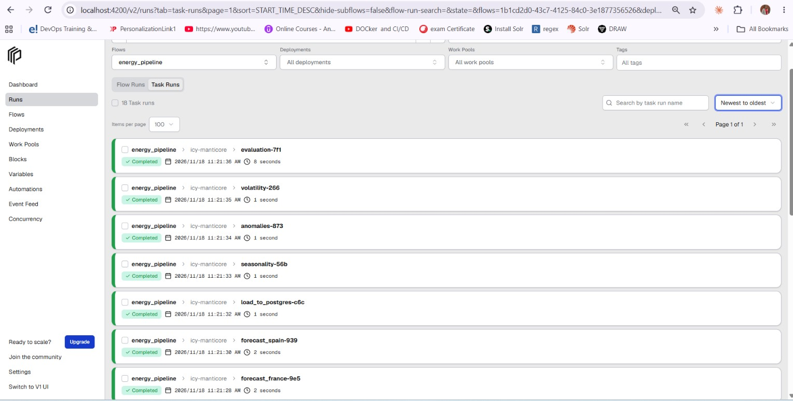

# European Day-Ahead Electricity Price Warehouse

An end-to-end data engineering project that ingests hourly day-ahead electricity prices for **Germany-Luxembourg, France, Spain and Belgium** from the ENTSO-E Transparency Platform, models them in a tested **dbt star schema** on PostgreSQL, and runs forecasting and analytics on top, all orchestrated with **Prefect** and runnable with **one Docker command**.



## Tech stack

| Layer | Tools |
|---|---|
| Ingestion | Python, ENTSO-E API (`entsoe-py`), pandas |
| Warehouse | PostgreSQL 16 |
| Transformation & tests | dbt (with `dbt_utils`) |
| Orchestration | Prefect 3 |
| Analytics | Prophet, ARIMA, Holt-Winters, STL decomposition (`statsmodels`) |
| Packaging | Docker, Docker Compose |

## Architecture

```
ENTSO-E API
    │  hourly prices, UTC, incremental + idempotent loads
    ▼
raw_dayahead_prices                  (PostgreSQL, raw layer)
    ▼
stg_dayahead_prices                  (dbt staging: long format, local time added)
    ▼
fct_dayahead_prices ── dim_country   (dbt star schema)
         │           └ dim_date
         ▼
int_prices_hourly_wide               (dbt intermediate: one column per country)
    ▼
marts: daily_average_prices, hourly_price_trends, rolling_averages,
       volatility, anomalies, country_comparison
    ▼
Python analytics: forecasts, seasonality, anomaly detection, model backtest
```

Everything runs as one Prefect flow: `ingest → dbt build → forecasts → load → seasonality → anomalies → volatility → evaluation`.

## Quick start

Requirements: Docker Desktop and a free ENTSO-E API token ([register here](https://transparency.entsoe.eu/), then request API access).

```bash
git clone https://github.com/Harman0791/german-energy-analytics-warehouse.git
cd german-energy-analytics-warehouse
cp .env.example .env          # then add your ENTSO-E token

docker compose up -d db prefect
docker compose up pipeline
```

- The first run on an empty database automatically loads the full history since 2023 (~20 minutes).
- Prefect UI: http://localhost:4200
- PostgreSQL: `localhost:5433` (credentials from `.env`)

## Data model

| Model | Grain | Purpose |
|---|---|---|
| `raw_dayahead_prices` | timestamp_utc × bidding_zone | Exactly what the API delivered |
| `stg_dayahead_prices` | timestamp_utc × bidding_zone | Cleaned, typed, local date/hour added |
| `fct_dayahead_prices` | timestamp_utc × bidding_zone | Fact table (materialized as table) |
| `dim_country` | bidding_zone | From a dbt seed |
| `dim_date` | date | Generated date spine (weekday, weekend flag, ...) |
| `int_prices_hourly_wide` | timestamp_utc | Pivot feeding the wide-format marts |

**59 dbt tests** run on every pipeline run, including unique keys, not-null checks, a price range check (−500 to 5,000 €/MWh), allowed bidding zones, and relationship tests between the fact and dimension tables. Because the pipeline uses `dbt build`, a failing test stops the run before bad data reaches the forecasts.

## Engineering decisions

- **UTC timestamps as keys.** Local time has a missing hour in spring and a repeated hour in autumn (daylight saving time). An earlier CSV version of this project had exactly these duplicates and gaps. Storing UTC removes the problem; local time is only derived for analysis.
- **15-minute to hourly.** Since 1 October 2025 the EU day-ahead market clears in 15-minute intervals. Ingestion averages them to hourly values (the same method as the official hourly index), so the full history has one consistent resolution.
- **Idempotent loads.** Each chunk deletes its exact time range and re-inserts it in one transaction. Re-running the pipeline never creates duplicates, and a primary key enforces this in the database too.
- **Incremental by default.** Daily runs reload only the last 7 days (picking up late corrections). A full reload runs automatically on an empty database, or manually with `--full`.
- **Monthly chunks.** Large requests silently lost one hour per year at internal boundaries of the API client. Monthly chunks fixed it, verified by a NULL-count check before and after.
- **Retry with backoff.** The ENTSO-E API occasionally returns server errors. Failed requests are retried with increasing waits, and only the error type is logged, so the API token never appears in logs.
- **Reproducible environment.** Python version, all packages and the Prefect server image are pinned. Containerising the project exposed several hidden local assumptions (an unpinned driver change, a manually loaded seed, tables assumed to exist), which are now fixed.
- **Validated data.** Loaded prices were cross-checked against independent sources (SMARD / Energy-Charts).

## Key findings

**Weekend prices are about 25% lower** (2025 averages, €/MWh):

| Country | Weekday | Weekend |
|---|---|---|
| Germany & Luxembourg | 96.21 | 72.03 |
| Belgium | 88.58 | 67.49 |
| Spain | 70.97 | 51.02 |
| France | 66.06 | 48.56 |

France is the cheapest of the four markets; Germany is the most expensive.

**November 2026 price spike.** In the 30 days up to 17 November 2026, the German daily average price was 214.50 €/MWh (standard deviation 80, range 13 to 351), more than double the 2025 average, driven by high gas prices and low wind.

**Model backtest** (train until 18 Oct 2026, test 19 Oct – 17 Nov 2026, MAE in €/MWh, lower is better):

| Model | France | Germany | Spain |
|---|---|---|---|
| ARIMA | 66.35 | 82.28 | 56.68 |
| Holt-Winters | **63.47** | **62.49** | 84.18 |
| Prophet | 80.25 | 79.49 | 65.47 |
| Seasonal naive (baseline) | 67.92 | 72.41 | **49.48** |

Holt-Winters beat the baseline for France and Germany; for Spain, no model beat it. Models trained only on past prices could not anticipate the regime shift of the test month, whose prices were driven by gas prices and weather.

## Limitations and next steps

- The backtest uses a single 30-day window. Shifting it by one day changed the best model for France, so a **rolling backtest** over many windows is the next step.
- The models only use past prices. Adding **wind and solar forecasts, load forecasts and gas prices** (partly available from ENTSO-E) should improve accuracy most.
- MAPE is reported but unreliable for electricity prices, which can be close to zero or negative; MAE is the main metric.
- The wide pivot lists the four zones explicitly; with many zones, the columns should be generated (e.g. `dbt_utils.pivot`).

## Repository structure

```
analytics/
  ingestion/      ENTSO-E fetch + idempotent load
  forecasting/    Prophet (DE), ARIMA (FR), Holt-Winters (ES), load to Postgres
  seasonality/    STL decomposition
  anomalies/      anomaly detection
  volatility/     volatility statistics
  evaluation/     backtest of all models vs. baseline
  prefect/        pipeline flow
dbt/models/
  sources/ staging/ dims/ facts/ intermediate/ marts/
seeds/            bidding zone reference data
docker/           dbt profile for Docker
Dockerfile, docker-compose.yml
```